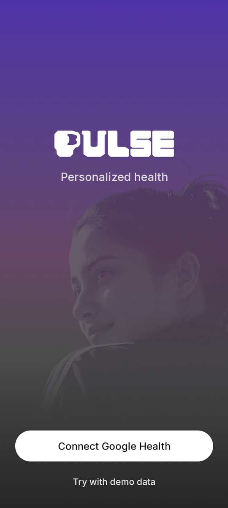
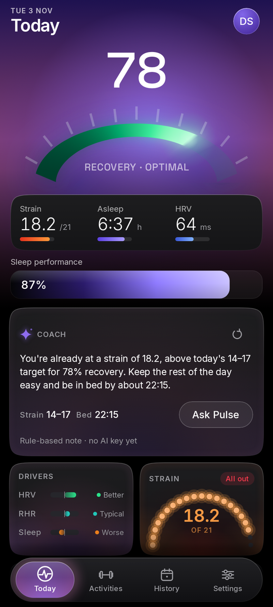
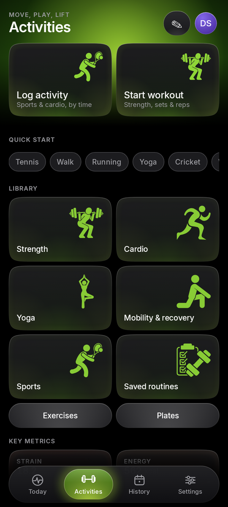
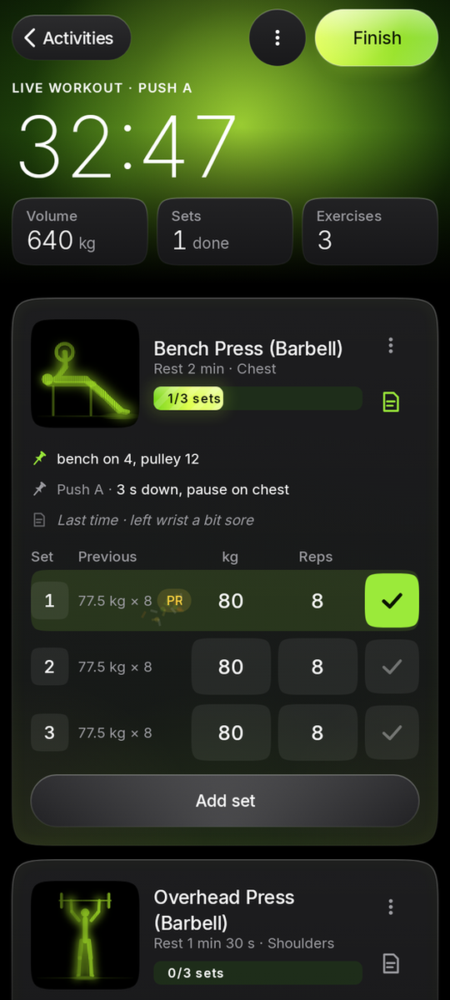

  

<h1 align="center">Pulse</h1>

Recovery, strain, sleep and workouts in one Android app. 
Free. No account. Your data stays on your phone.

<a href="../../releases/latest"><b>Download Pulse v1 (APK)</b></a>

  
  
  
  

## What you get

- **Recovery, Strain and Sleep** every day from your wearable, with the maths shown.
- **Workout log** with routines, rest timer, history and PRs.
- **Meals, weight and meditation** in the same place.
- **Ask Pulse**, an AI coach on your own API key (OpenAI, OpenRouter, Google AI Studio and more).

Works with anything that writes to Health Connect: Fitbit and Google Health, Samsung Health, Garmin and others.

## Install

1. Download `Pulse-v1.apk` from [Releases](../../releases/latest) and open it.
2. Allow installs from your browser if Android asks.
3. Open Pulse and connect Google Health.

Android only for now.

## Privacy

No ads, no analytics, no Pulse servers. Nothing leaves your phone unless you turn on Google Drive backup or Ask Pulse.

Scores are estimates for general fitness, not medical advice. Found a bug? Open an issue.
