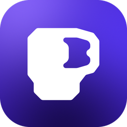
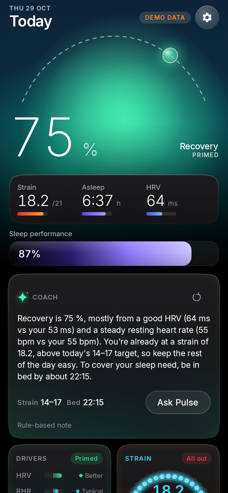
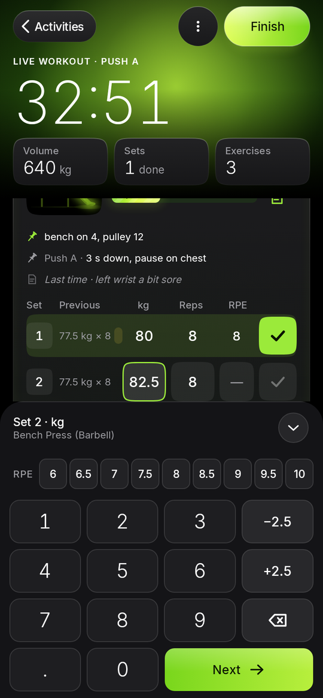
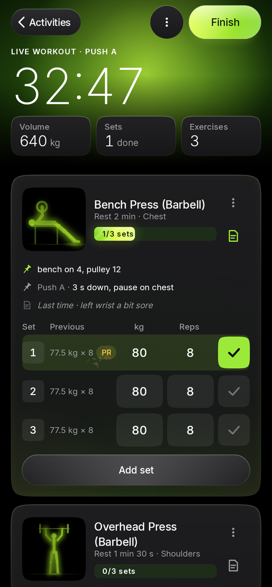
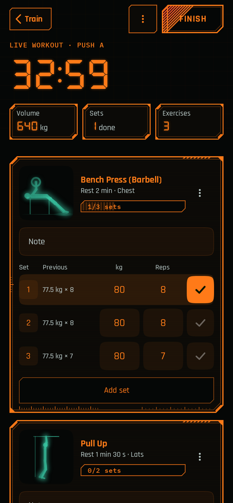

  

<h1 align="center">Pulse</h1>

Recovery, strain, sleep and a workout log for Android. 
Free. No account. Your data stays on your phone.

<a href="../../releases/latest"><b>Download the latest APK</b></a>

  
  
  
  

## What it does

- Reads your wearable data from Health Connect (Fitbit / Google Health, Samsung Health, Garmin and others) and works out daily Recovery, Strain and Sleep scores. You can see how each score is calculated.
- Logs workouts: routines, sets, rest timer, history and PRs.
- Logs meals, weight, meditation and sports.
- Optional AI coach using your own API key.
- Imports an Apple Health export if you're moving from an iPhone.
- Six themes.

## Install

1. Download `Pulse-v1.apk` from [Releases](../../releases/latest).
2. Open it. Android will ask you to allow installs from your browser or file manager.
3. Open Pulse and allow Health Connect access.

Android only. Not on the Play Store yet.

## Back up your data

Settings → Data & sync → Cloud backup → Back up now. This saves to a private folder in your own Google Drive.
You can also export everything from Settings → Your data → Export & share.

## Privacy

No ads, no analytics, no Pulse servers. Health data is read on the phone. Nothing leaves it unless you turn on Drive backup or the AI coach, which sends your question straight to the AI provider you chose.

## Notes

- Scores are estimates for general fitness, not medical advice.
- Found a bug? Open an issue.
